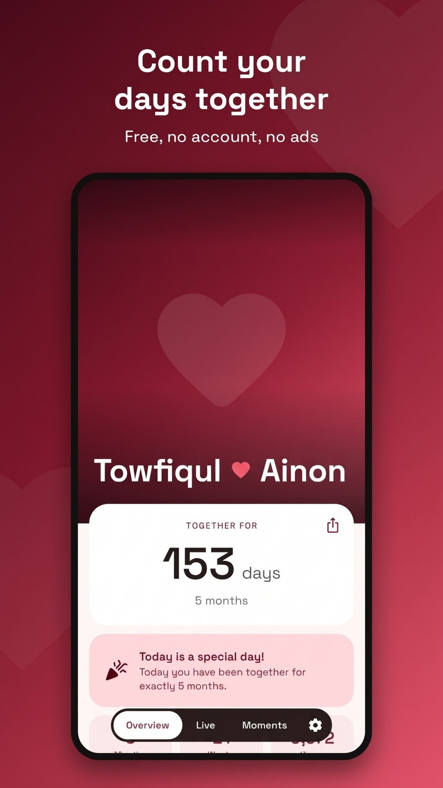
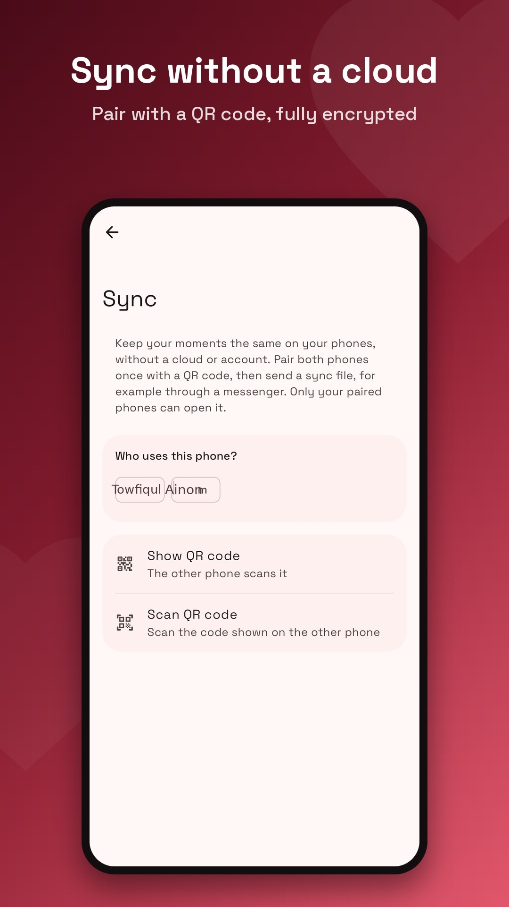
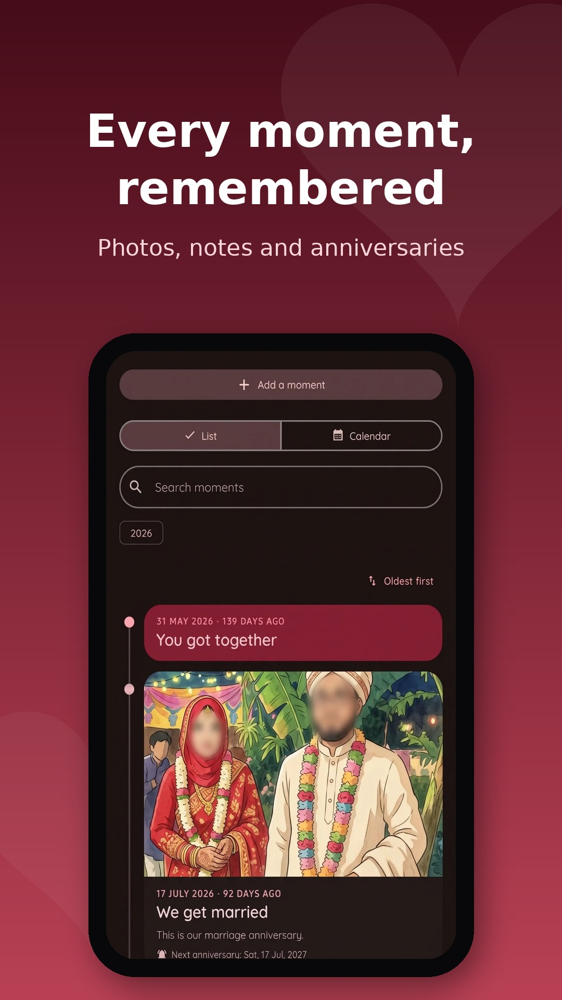
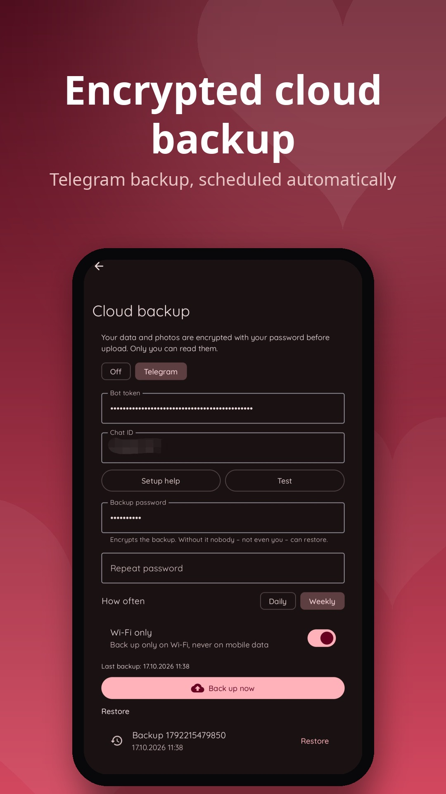
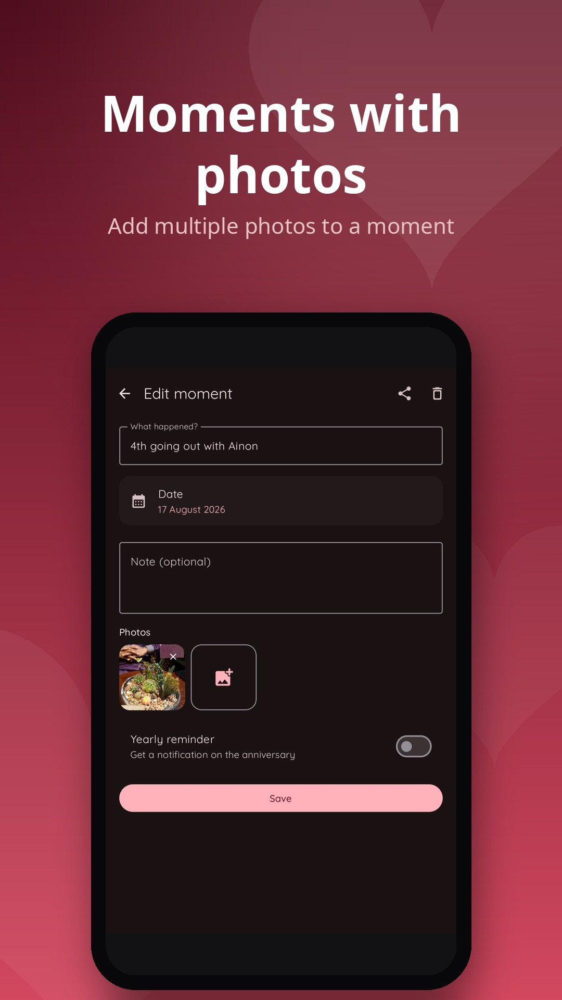

# Our Days

A privacy-friendly Android app for couples: counts how long you have been together and reminds you of every special day. Available in English and Bengali.

  
  
  
  
  

## Features

- Days, weeks, months and hours together, plus a live counter down to the second
- Your own photo with adjustable framing, or one of several backgrounds, plus an optional slideshow with more photos
- Notifications on monthly and yearly anniversaries, every 100 days, fun numbers like 222 and every 50 weeks, at a time you choose
- Upcoming special days with a countdown
- Moments: a timeline of important moments with notes, multiple photos per moment and yearly reminders (can be hidden)
- Quick-add button for new moments, right on the Moments tab
- Two home screen widgets: a love card with your names and days together, and a compact counter in Material You colors
- Guided setup, optional start time, one-tap "delete all data"
- Backup as a file (all data and photos) to move to a new phone, without internet
- Encrypted cloud backup: automatic daily or weekly backups to your own Telegram bot or Google Drive (Play version), encrypted with your password (AES-256-GCM) before upload, with Wi-Fi-only option and restore from the cloud
- Sync between phones without a server: pair once with a QR code, then send each other an encrypted file (AES-256-GCM) that opens right in the app and only on your paired phones
- Light and dark mode, English and Bengali, language can be changed right in the app
- Our Entertainment: play together even when apart — async Dots and Boxes and Gomoku over the pairing channel (no server, no account), solo games against the AI (easy/hard), couples quizzes ("how well do you know me", would-you-rather) and a daily challenge that is identical on both phones with no server
- No account, no ads, no tracking, all data stays on the device unless you enable cloud backup yourself
- Poly mode: more than two people and several relationships, each with its own date, special days and reminders, plus a discreet mode with initials only
- For every kind of love, no matter who you are, whom you love or how many of you there are, with a little rainbow decoration in Pride Month (June)

## Third-party libraries

Our Days uses Android Jetpack (AndroidX, Jetpack Compose, Material 3, Glance, DataStore, WorkManager), Kotlin and kotlinx.coroutines, Coil, Okio, Guava ListenableFuture, Accompanist, JSpecify, Material Symbols, ZXing and ZXing Android Embedded (QR codes), and OkHttp. All of them are licensed under the [Apache License 2.0](https://www.apache.org/licenses/LICENSE-2.0). The app lists them under *Settings → Open source licenses*. The Play version additionally uses Google Play services (play-services-auth) for Google Drive sign-in.

## Download

| Where | Updates |
| --- | --- |
| [GitHub Releases](https://github.com/MDTowfiqul/Our-Days/releases) | The app checks GitHub once a day, notifies you and installs the update with one tap (can be turned off). Also works with [Obtainium](https://github.com/ImranR98/Obtainium). |
| Google Play | Through the Play Store (planned) |

Tip: if notifications arrive late, set *Settings → Apps → Our Days → Battery* to "Unrestricted".

## Build variants

| Variant | Gradle task | Internet | Updates |
| --- | --- | --- |
| `github` | `./gradlew assembleGithubRelease` | update check and cloud backup | GitHub Releases |
| `fdroid` | `./gradlew assembleFdroidRelease` | none | F-Droid |
| `play` | `./gradlew bundlePlayRelease` | update check and cloud backup | Google Play |

Tests, screenshots and store graphics: `./gradlew testGithubDebugUnitTest` (output in `app/build/screenshots` and `app/build/store`).

## Releasing

- **Signing:** create `keystore.properties` (not committed) with `storeFile`, `storePassword`, `keyAlias`, `keyPassword`. Without it, release builds stay unsigned (this is what F-Droid expects). In GitHub Actions the secrets `UPLOAD_KEYSTORE_BASE64`, `UPLOAD_KEYSTORE_PASSWORD`, `UPLOAD_KEY_ALIAS` and `UPLOAD_KEY_PASSWORD` are used.
- **Releases are made on purpose:** changes collect on the default branch until a release is started by hand (Actions > Release > Run workflow, type `auto`, `patch`, `minor` or `major`; `auto` honors `[minor]`/`[major]` in commit messages). The workflow bumps the version, checks that `fastlane/metadata/android/{de-DE,en-US}/changelogs/<versionCode>.txt` exist (at most 500 characters, shown in the app, on F-Droid and on GitHub), runs the tests, builds all variants, then commits the version, tags `v<versionName>` and publishes the signed APK. F-Droid builds every new tag. Every app change adds a line to the notes for the next versionCode; the Build workflow warns while they are missing. Pull before working, since the release workflow pushes version commits.
- **F-Droid** builds the `fdroid` variant from source; store texts and images are in `fastlane/`, a metadata template is in `fdroid/`.
- **Website:** `docs/` (landing page and privacy policy) is published via GitHub Pages and can be copied to any static web server.

## Tech

Kotlin, Jetpack Compose (Material 3), Glance widgets, DataStore, Coil. Minimum Android 8.0.

## Website

https://mdtowfiqul.github.io/Our-Days/ (privacy policy: [English](docs/privacy-en.html), [বাংলা](docs/privacy-bn.html))

## How this app was made

This app was developed with AI assistance: the code was written with the help of an AI coding assistant and reviewed, tested and directed by the maintainer.

## Credits

Our Days is a fork of [Since Us](https://github.com/DerDieDasLian/sinceus) by Lian Wassen, used under the GNU General Public License v3.0 or later.

## License

[GNU General Public License v3.0 or later](LICENSE)
